# `php127` — Machine Virtuelle PHP 8.3 en Go 1.27 Pur (Zéro CGO), Noyaux SIMD AVX2 & Observabilité Matérielle PMU

[](https://go.dev/)
[](#)
[](#)
[](README.md)

`php127` est un moteur d'exécution PHP 8.3 autonome écrit en Go 1.27 pur (zéro CGO, zéro dépendance externe). Il remplace les pointeurs d'union C (`zval`) et le comptage de références par valeur (`Rc<RefCell<...>>`) par une **structure `types.Value` de 16 octets sans pointeur** (deux registres de 64 bits) adossée à une **arène `Zone` isolée par requête** dont la réinitialisation (`Zone.Reset()`) s'exécute en **195 instructions CPU**.

---

## Monographie Technique & Bancs de Mesure (`docs/`)

La monographie complète (incluant les 15 planches haute définition issues des compteurs matériels Linux `perf_event_open` et le guide opérationnel de sécurité et d'observabilité) est versionnée dans [`docs/article_x_micro_design_for_cybersafety.docx`](docs/article_x_micro_design_for_cybersafety.docx), accompagnée de l'instantané JSON [`probebench/testdata/latest_metrics.json`](probebench/testdata/latest_metrics.json).

---

## Couverture WordPress 6.9.4 & Extensions Zéro-CGO

`php127` exécute l'ensemble de la surface PHP 8.3 requise par WordPress 6.9.4 en Go pur (zéro CGO) :
- **Instantanés de bootstrap `ARCHTIME` en `ProcessZone` (`vm/archtime.go`, `types/string.go`)** : promotion en mémoire de processus immuable (`RefCount = math.MaxUint32`, séparation Copy-on-Write à l'écriture) des fonctions, classes, constantes, grands tableaux (`$allowedposttags`) et objets globaux (`WP_Token_Map`).
- **Base de données (`mysqli/`, `pdo/`)** : API `mysqli` procédurale et objet complète (protocole MySQL natif ou traducteur SQLite embarqué sans CGO) et `PDO` (`sqlite`).
- **Médias, Archives & Fileinfo (`ext/gd.go`, `stdlib/wp_sys.go`)** : `GdImage` (`WP_Image_Editor_GD`, redimensionnement bilinéaire `imagecopyresampled`, rotation, retournement, PNG/JPEG/GIF avec contrôle des dimensions avant décodage), `finfo` (`finfo_open`, `finfo_file`, `finfo_buffer`, `mime_content_type`) et `PclZip`.
- **Transport HTTP, XML & Protocoles de flux (`ext/curl_xml.go`, `streams/userwrapper.go`, `vm/userwrapper.go`)** : `CurlHandle` (`curl_exec` avec rappels `CURLOPT_WRITEFUNCTION` et `CURLOPT_HEADERFUNCTION` pour `WpOrg\Requests\Transport\Curl`), parseur SAX `XMLParser` (`xml_parse`, `xml_parse_into_struct` pour `IXR_Message`), sockets TLS/asynchrones et protocole complet `stream_wrapper_register`.
- **Cryptographie, I18n & SAPI Multipart (`ext/openssl_pkey.go`, `ext/intl.go`, `stdlib/bcrypt.go`, `sapi/superglobals.go`)** : signatures OpenSSL (RSA/ECDSA/Ed25519), UTS#46 `idn_to_ascii`/`idn_to_utf8`, `Normalizer` Unicode, Eksblowfish `$2y$`/`$2a$`/`$2b$`, `php://input` et `multipart/form-data` `$_FILES` (clés à crochets et codes `UPLOAD_ERR_*`).

---

## Démarrage Rapide

```bash
# Compiler le binaire autonome
go build -o php127 ./cmd/php127

# Exécuter les tests avec la garde d'invariants de pile (-tags vmcheck)
go test -tags vmcheck -race -count=1 ./zone/... ./types/... ./lexer/... ./parser/... ./bytecode/... ./compiler/... ./stdlib/... ./ext/... ./mysqli/... ./streams/... ./vm/... ./sapi/...

# Lancer les sondes matérielles PMU (M0a..M6 et matrice 2D F x D)
go test -v -count=1 -run "TestAtomicMicroProbes|TestStratifiedFunctionAndDataMatrix" ./probebench/...
```

---

# MICRO-DESIGN FOR CYBERSAFETY : Quand l'optimisation au cycle d'horloge verrouille la sécurité de PHP

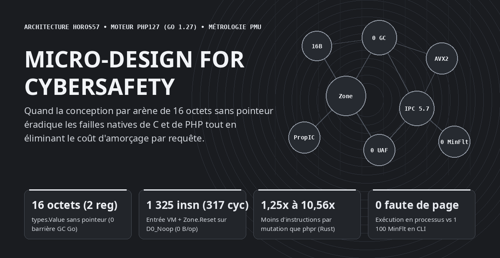

## D'une anecdote de langages au terrier microarchitectural

Excité à l'idée qu'enfin quelqu'un ait réimplémenté PHP, j'ai voulu tenter l'aventure en Go. Une fois le gros du code fonctionnel, viennent les premiers benchs. Je trouve les patterns habituels, je fais mon taf usuel sur le GC, les registres, le ruban perpétuel givré, etc. Mais dans le même temps, je découvre PHP. Certaines pratiques d'optimisation méritent d'être exploitées pour réduire les failles natives de C, et de PHP.

Au départ, l'exercice ressemblait à une confrontation classique entre langages systèmes : mesurer sur un même processeur Intel Core i9-14900K (cœur haute performance Golden Cove épinglé sur le cœur 0) le moteur officiel PHP 8.3.6 écrit en C, une réimplémentation récente en Rust (phpr) et notre propre moteur écrit en Go 1.27 (`php127`, conçu selon les règles d'architecture `horos57`). Mais dès que l'on ouvre les compteurs matériels du processeur (`perf_event_open` sur `cpu_core` : instructions retirées, cycles CPU, accès et défauts de cache L1D et L3, fautes de pages mineures du noyau Linux), la comparaison entre Go et Rust passe au rang de simple anecdote qui a ouvert le terrier de lapin.

Ce que révèle le profilage matériel à l'échelle du cycle d'horloge, c'est une convergence inattendue : **les décisions de micro-design qui permettent d'atteindre zéro octet d'allocation au ramasse-miettes par tour de boucle chaude, 1 325 instructions (317 cycles) d'entrée et de purge dans la machine virtuelle et jusqu'à 5,73 instructions retirées par cycle sont exactement les mêmes choix structurels qui éliminent les classes historiques de failles de sécurité du moteur C et de PHP.**

---

## Le Benchmark Global de bout en bout : PHP 8.3.6 (C) vs `phpr` (Rust) vs `php127` (Go 1.27)

Avant d'entrer dans l'anatomie microarchitecturale, voici la photographie globale de bout en bout (temps mural médian en millisecondes et instructions totales retirées par le processeur sur 11 passages, avec parité `Stdout` exacte bit à bit) sur les 8 familles d'opérations fondamentales d'un moteur PHP, complétée par le banc de charge HTTP SAPI complet (**2 000 requêtes `POST` concurrentes** sur 32 goroutines avec PDO SQLite transactionnel, PCRE, SHA-256 et JSON soutenant **8 255 requêtes/seconde** à `3,84 ms` de latence médiane dans 16 arènes `Zone` recyclées sans aucune fuite) :

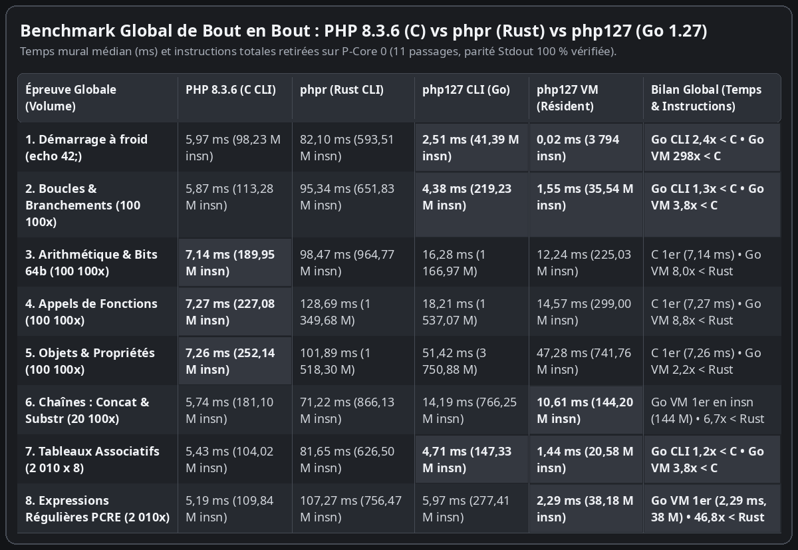

---

## Les 6 piliers du Micro-design : 1 carte visuelle et 1 puce par mécanisme

Chaque goulet matériel résolu par l'architecture `horos57` se résume en une carte visuelle à quatre cadrans (le défaut natif PHP ou C, le principe de résolution microarchitectural, la mesure matérielle aux compteurs PMU et le dividende sécuritaire), suivie d'une puce explicative.

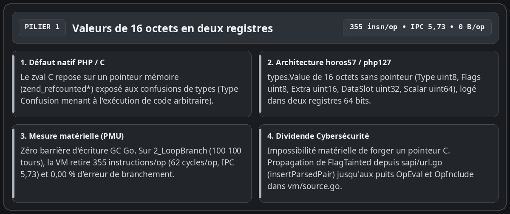

- **Du pointeur `zval` C à la valeur de 16 octets en deux registres 64 bits** : Dans le moteur C officiel, chaque variable PHP repose sur une structure contenant un pointeur mémoire brut vers la valeur comptée par références, ce qui ouvre la porte aux confusions de types exploitables. Dans `php127`, `types.Value` occupe exactement **16 octets** et tient dans **deux registres 64 bits** sans aucun pointeur mémoire (`Type uint8`, `Flags uint8`, `Extra uint16`, `DataSlot uint32` indexé dans l'arène et `Scalar uint64`). Le compilateur Go n'émet aucune barrière d'écriture pour le ramasse-miettes, toute forge de pointeur devient matériellement impossible, et le bit de marquage des entrées HTTP (`FlagTainted`, posé dès `insertParsedPair` / `newTaintedStr` dans `sapi/url.go`) se propage en registre jusqu'aux puits `OpEval` et `OpInclude` dans `vm/source.go`.

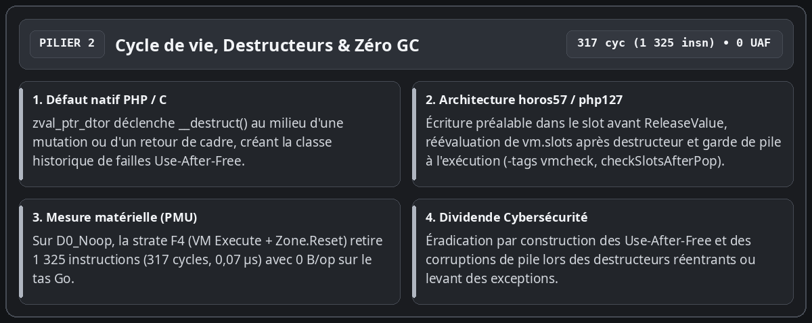

- **Éradication des failles Use-After-Free sur les destructeurs et exécution à zéro ramasse-miettes** : La première source historique de failles critiques dans l'interpréteur PHP survient lorsqu'un destructeur utilisateur (`__destruct()`) se déclenche au milieu de la modification d'un conteneur ou au retour d'une fonction, libérant ou réallouant la pile pendant que le moteur détient une ancienne référence. Dans `php127`, la nouvelle valeur est systématiquement écrite dans son slot avant `ReleaseValue`, tout accès à `vm.slots` est réindexé après un appel susceptible de réallouer la pile, et la garde d'exécution sous étiquette de compilation `-tags vmcheck` (`checkSlotsAfterPop`) vérifie à chaque `popFrame()` qu'aucun slot résiduel ne subsiste au-dessus du sommet de pile. Sur la sonde minimale `D0_Noop`, la strate `F4` (`VM Execute + Zone.Reset`) retire exactement **1 325 instructions** (**317 cycles**, 0,07 microseconde) avec **0 octet alloué sur le tas Go**.

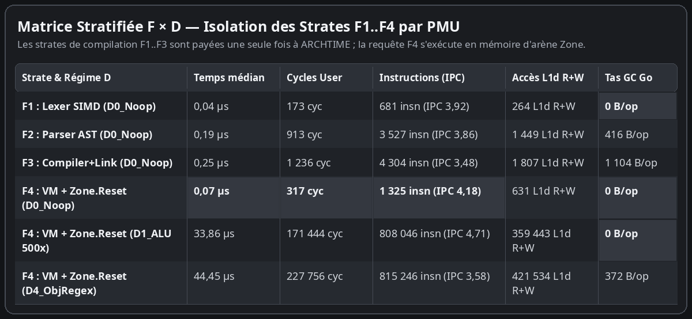

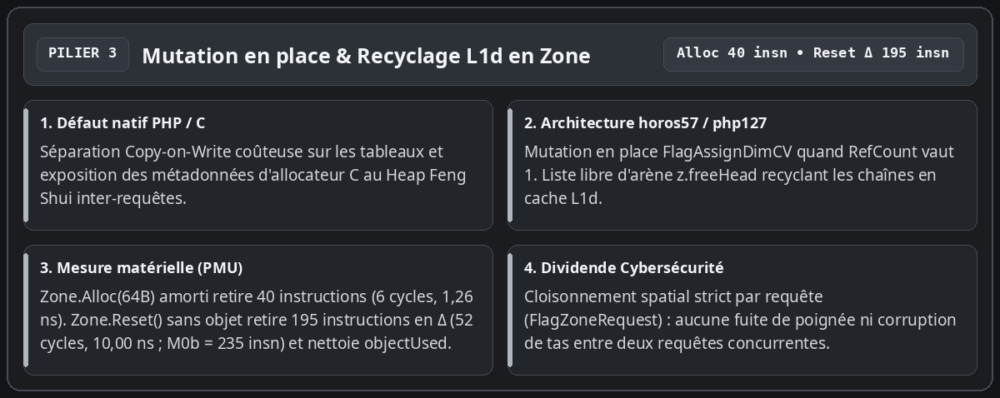

- **Mutation en place des tableaux (`FlagAssignDimCV`) et coûts atomiques d'arène (`Zone.Alloc` vs `Zone.Reset`)** : Au lieu de dupliquer défensivement un tableau lors d'une écriture `$h[$k] = $v` ou d'exposer les métadonnées d'un allocateur C au *Heap Feng Shui*, l'indicateur `FlagAssignDimCV` mute l'entrée sur place dès lors que `RefCount` vaut 1, tandis que les chaînes temporaires libérées sont recyclées en tête de liste libre (`z.freeHead`) dans le cache L1d. Nos sondes atomiques dédiées séparent les deux primitives : une allocation `Zone.Alloc(64B)` amortie retire **40 instructions** (**6 cycles**, 1,26 nanoseconde), tandis qu'un `Zone.Reset()` sans objet retire **195 instructions** en coût différentiel `M0Δ` (**52 cycles**, 10,00 nanosecondes ; **235 instructions** et **58 cycles** pour `M0b` complet) en remettant le curseur d'octets (`z.offset = 0`, `z.freeHead = 0`) à zéro en temps constant $O(1)$ et en nettoyant la tranche des objets alloués dans la requête ($O(\text{objectUsed})$).

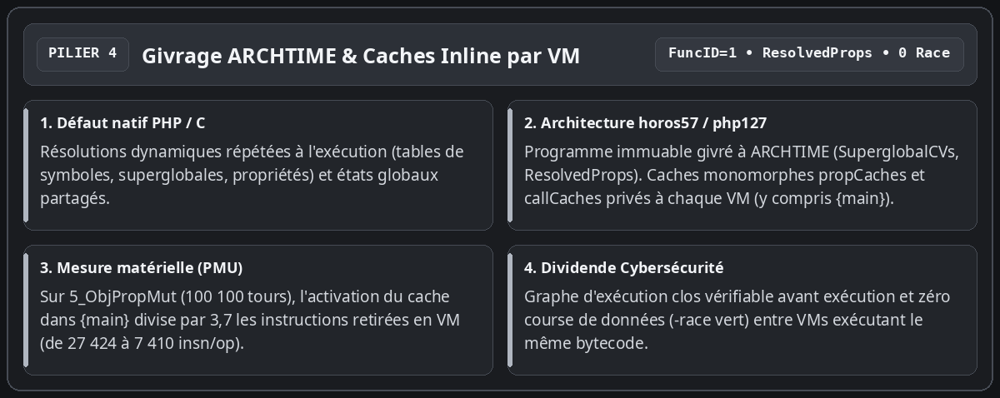

- **Ruban perpétuel givré à ARCHTIME (`ResolvedProps`) et caches monomorphes actifs dès `{main}`** : Les superglobales (`SuperglobalCVs`) et la table aplatie des propriétés d'instance (`ResolvedProps` dans `bytecode/program.go`) sont résolues et scellées une seule fois à la liaison (`bytecode.Link`). L'attribution d'un identifiant `FuncID = 1` au programme principal `{main}` active les caches monomorphes `propCaches` et `callCaches` dès la racine du script : sur les 100 100 itérations de `5_ObjPropMut`, cette activation divise par **3,7** le nombre d'instructions retirées en VM (de 27 424 à **7 410 instructions par itération**), sans aucune course de données entre goroutines concurrentes (`-race` vert).

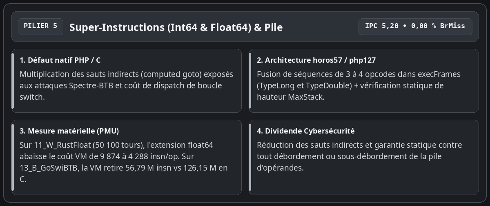

- **Super-instructions fusionnées (`TypeLong` et `TypeDouble`) et vérification statique `MaxStack`** : Pour réduire le coût de dispatch de la boucle `switch` de `execFrames` sans multiplier les sauts indirects vulnérables à Spectre-BTB, le moteur fusionne les séquences courantes de 3 à 4 opcodes (`OpLoadCV` + `OpAdd`/`OpSub`/`OpMul`/`OpIsSmaller` + `OpStoreCV`/`OpJmpZ`) tant sur les entiers 64 bits (`TypeLong`) que sur les flottants IEEE-754 (`TypeDouble`). Sur les 50 100 itérations de l'orbite de Julia (`11_W_RustFloat`), l'extension aux flottants abaisse le coût différentiel VM de 9 874 à **4 288 instructions par itération** (soit **3,09 fois moins d'instructions** que les 13 263 instructions de `phpr` en Rust). Sur `13_B_GoSwiBTB` (20 100 tours), la VM Go retire **56,79 millions d'instructions** (2,50 ms, IPC 5,20, 0,00 % de défaut de branchement) contre **126,15 millions** pour le binaire C (5,42 ms).

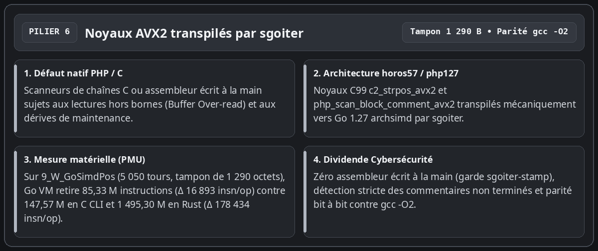

- **Transpilation mécanique de C99 vers Go AVX2 par `sgoiter`** : Aucun code vectoriel ni assembleur n'est écrit ou retouché à la main. Les noyaux `c2_strpos_avx2` et `php_scan_block_comment_avx2` sont écrits en C99, validés contre `gcc -O2`, puis transpilés mécaniquement par `sgoiter` vers Go 1.27 `simd/archsimd` avec vérification stricte des commentaires non terminés. Sur `9_W_GoSimdPos` (**5 050 itérations** sur un tampon de **1 290 octets**), la VM Go retire **85,33 millions d'instructions** (**16 893 instructions par opération** en delta) contre **147,57 millions d'instructions** pour le processus C CLI (**9 722 instructions par opération** en delta) et **1 495,30 millions d'instructions** pour `phpr` en Rust (**178 434 instructions par opération** en delta, soit **10,56 fois moins d'instructions** en Go VM qu'en Rust).

---

## Benchmarks fondamentaux (Épreuves 1 à 8) : Total bout-en-bout vs Delta marginal

Pour une lecture rigoureuse, il est indispensable de distinguer deux régimes que nos tableaux juxtaposent :
1. **Les trois colonnes CLI (`PHP 8.3.6 C`, `phpr Rust`, `php127 CLI Go`)** mesurent un sous-processus complet (`fork` + `execve`, chargement dynamique, analyse lexicale/syntaxique, compilation et exécution du script `HighN`).
2. **La colonne `php127 VM (In-Process)`** mesure l'exécution du programme précompilé (`ARCHTIME`) dans un worker Go résident suivie de `Zone.Reset()`, tandis que **le delta différentiel $\Delta = (\text{Run}(\text{HighN}) - \text{Run}(\text{LowN})) / \Delta N$** isole le coût marginal pur d'un tour de boucle hors démarrage et hors compilation (0 octet alloué sur le tas Go par tour de boucle sur les épreuves 1 à 5, l'enveloppe d'appel `Execute` complète représentant 96 à 112 octets).


---

## Sondes White & Black (Épreuves 9 à 15) : forces et points de friction

Sept sondes complémentaires ciblent les forces architecturales de chaque moteur (sondes blanches 9 à 11) ainsi que les points de friction microarchitecturaux de Go et de Rust (sondes noires 12 à 15), avec leurs comptes d'itérations `HighN` exacts.


---

## Ce que montre la comparaison honnête entre C, Rust et Go 1.27

L'examen croisé du coût complet (Volet 1) et du coût marginal par itération (Volet 2) permet de poser un diagnostic d'ingénierie précis et sans complaisance :

- **Pourquoi le moteur C (`PHP 8.3.6`) reste devant en delta marginal pur ($\Delta\text{insn/op}$) sur les boucles longues** : Le Zend Engine C compile son interpréteur avec un adressage indirect par opcode (*computed goto* en assembleur natif) et manipule directement des pointeurs en mémoire sans vérification de bornes. Par itération pure (Volet 2), il retire 2,0 à 4,8 fois moins d'instructions que `php127 VM` sur les boucles arithmétiques, objets et tableaux (`149` vs `355` insn/op sur `2_LoopBranch`, `1 534` vs `7 410` sur `5_ObjPropMut`, `35 987` vs `72 987` sur la récursion profonde `14_B_GoDeepRec`).
- **Pourquoi `php127 CLI` devance néanmoins `php 8.3 CLI` en temps mural sur 4 épreuves courtes (`1_ColdBoot`, `2_LoopBranch`, `7_HashArrayMut`, `15_B_RustCowDrp`)** : Un lancement CLI complet de `php -n` paie systématiquement environ **98 millions d'instructions** et **1 100 fautes de page mineures** pour charger l'exécutable C et ses bibliothèques partagées (`ld-linux`, extensions). Le binaire Go autonome `php127 CLI` ne paie que **41,39 millions d'instructions** et **894 fautes de page** au démarrage (`2,51 ms` contre `5,97 ms` sur `1_ColdBoot`, `4,38 ms` contre `5,87 ms` sur `2_LoopBranch`, `4,71 ms` contre `5,43 ms` sur `7_HashArrayMut` et `4,42 ms` contre `4,57 ms` sur `15_B_RustCowDrp`).
- **Pourquoi le mode résident `php127 VM` devance le sous-processus C sur 10 des 15 épreuves (`1`, `2`, `6`, `7`, `8`, `9`, `10`, `12`, `13`, `15`)** : En conservant le `*bytecode.Program` givré à `ARCHTIME` en mémoire et en exécutant chaque requête HTTP dans une `Zone` dont le curseur est réinitialisé en **195 instructions** (`Zone.Reset()`), le moteur élimine à la fois les ~98 millions d'instructions d'`execve`, les 1 100 fautes de page du noyau et la recompilation du script.
- **Pourquoi `php127 VM` retire 1,25 à 10,56 fois moins d'instructions par mutation que `phpr` (Rust) sur les 14 épreuves itératives** : De `5_ObjPropMut` (`7 410` vs `9 229` insn/op, soit `1,25x`), `15_B_RustCowDrp` (`16 647` vs `23 312`, `1,40x`) et `7_HashArrayMut` (`10 225` vs `15 916`, `1,56x`) jusqu'à `11_W_RustFloat` (`4 288` vs `13 263`, `3,09x`) et `9_W_GoSimdPos` (`16 893` vs `178 434`, `10,56x`), le découplage entre valeurs de 16 octets sans pointeur et arène indexée évite les clonages défensifs et les cascades de `Rc::clone` / `Drop` par valeur.

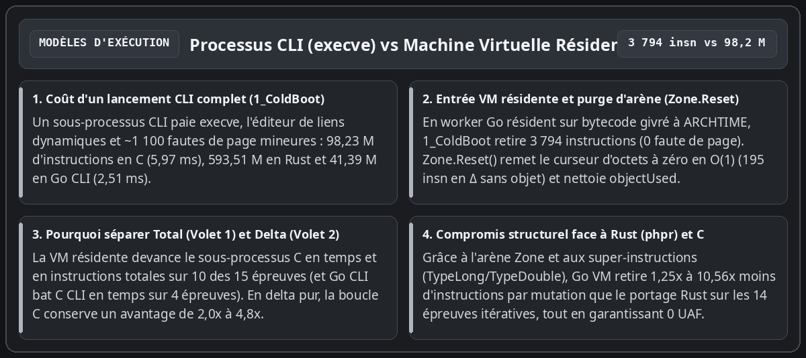

---

## Marquage de contamination (`FlagTainted`) et observabilité déterministe

Le dernier enseignement de cette exploration concerne la sécurité d'exécution en production. Dans un serveur PHP traditionnel en C, le suivi fin des entrées utilisateur ou l'inspection des puits sensibles impose une instrumentation lourde.

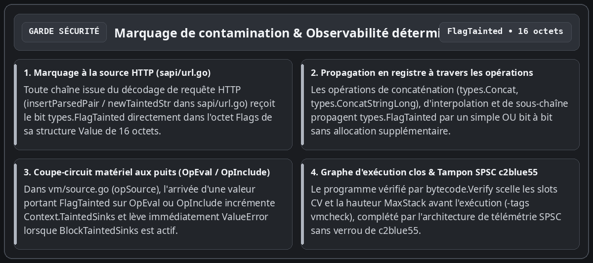

Dans `php127`, la sûreté s'appuie directement sur les invariants de la machine virtuelle :

- **Marquage dès la source HTTP (`sapi/url.go`) et propagation dans les 16 octets de `types.Value`** : Toute chaîne décodée depuis les paramètres de requête (`insertParsedPair` / `newTaintedStr` dans `sapi/url.go` et `sapi/errors.go`) reçoit le bit `types.FlagTainted` dans le champ `Flags` de sa structure `Value`. Les concaténations (`types.Concat`, `types.ConcatStringLong`), interpolations et extractions de sous-chaînes propagent ce bit par un simple `OR` binaire en registre.
- **Coupe-circuit matériel aux puits d'exécution (`OpEval` et `OpInclude` dans `vm/source.go`)** : Lorsqu'une valeur portant `FlagTainted` atteint `opSource` (`OpEval` ou `OpInclude`), la machine virtuelle incrémente le compteur de requête `Context.TaintedSinks` et, dès que `Context.BlockTaintedSinks` est activé, interrompt immédiatement l'instruction en levant une `ValueError` (`"Tainted input rejected at ..."`) avant toute analyse ou exécution du code injecté.
- **Graphe d'exécution clos (`bytecode.Verify`) et garde de pile à l'exécution (`-tags vmcheck`)** : Chaque `OpArray` est vérifié statiquement avant exécution (`MaxStack`, indices de variables compilées `NumCVs`, cibles de saut), et la garde `checkSlotsAfterPop` (`-tags vmcheck`) vérifie l'intégrité de la pile d'opérandes à chaque retour de cadre.

---

## Conclusion : guide pratique de la sécurité et de l'observabilité dans `php127`

Au-delà des mesures comparatives entre C, Rust et Go 1.27, cette architecture apporte deux ensembles de garanties opérationnelles directement exploitables pour exécuter du code PHP : des **adjonctions de sécurité structurelles** au langage et une **observabilité déterministe** (applicative et matérielle). Voici ce que tout utilisateur ou intégrateur doit connaître pour les mettre en œuvre.

### 1. Adjonctions de sécurité à PHP : ce que fait `php127` et comment l'utiliser

La gestion de la sécurité dans `php127` se divise en **invariants structurels actifs par défaut** (qui protègent tout script PHP sans modifier une seule ligne de code) et en **mécanismes de politique configurables** (marquage de teinte et confinement SAPI).

#### A. Garanties actives par défaut (sans configuration)
1. **Élimination des confusions de types et des corruptions de pointeurs (`types/value.go`)** : Contrairement au `zval` C (qui stocke des pointeurs bruts `zend_string*`, `zend_array*`, `zend_object*` dans une union C), `types.Value` est une structure purement numérique de 16 octets (`Type`, `Flags`, `Extra`, `DataSlot uint32`, `Scalar uint64`). Un bug logique ne peut jamais forger une adresse mémoire arbitraire.
2. **Neutralisation des *Use-After-Free* sur réentrance de destructeurs (`vm/value.go`, `vm/array.go`)** : Lorsqu'une affectation écrase une variable (`writeCV`, `storeCVMove`) ou un élément de tableau (`ArraySet`) contenant un objet doté d'un `__destruct()`, `php127` écrit systématiquement la nouvelle valeur dans l'emplacement **avant** d'appeler `ReleaseValue` sur l'ancienne. Même si le destructeur PHP relit le tableau global, lève une exception ou force la réallocation de la pile `vm.slots`, l'état observé est toujours cohérent.
3. **Isolation mémoire inter-requêtes et validation d'époque $O(1)$ (`zone/zone.go`)** : Chaque requête s'exécute dans sa propre `Zone`. Toute lecture d'un `DataSlot` vérifie que l'identifiant d'époque (`z.epoch`) et le drapeau `FlagZoneRequest` concordent ; à la fin de la requête, `Zone.Reset()` incrémente l'époque et remet le curseur d'octets à zéro en 195 instructions, rendant impossible toute fuite de données d'une requête HTTP vers la suivante.
4. **Vérification statique du bytecode avant exécution (`bytecode/verify.go`)** : Tout `OpArray` compilé ou chargé passe par `bytecode.Verify`, qui valide les bornes de saut, les indices de variables compilées (`NumCVs`), les indices de constantes et la profondeur maximale de pile (`MaxStack`) avant que `vm.Execute` n'exécute la première instruction.
5. **Confinement des pannes par requête (`vm/vm.go`, `sapi/server.go`)** : Les frontières `vm.Execute` et `sapi.Server.ServeHTTP` intègrent un `recover()` de confinement qui transforme toute anomalie interne en sortie contrôlée (code `255` en CLI ou HTTP `500` sur la seule requête fautive) sans jamais abattre le processus serveur résident.

#### B. Comment utiliser le suivi de teinte (`FlagTainted`) et le serveur SAPI
Dans un déploiement HTTP ou lors de l'audit d'une application PHP existante, `php127` permet de suivre automatiquement les entrées non fiables de la requête jusqu'aux puits d'exécution (`eval`, `include`, `require`) :

- **Marquage automatique des entrées HTTP** : Lorsque la requête entre par `sapi.Server` (ou `sapi.PopulateSuperglobals`), le parseur `insertParsedPair` (`sapi/url.go`) marque automatiquement chaque clé et chaque valeur de `$_GET`, `$_POST`, `$_COOKIE` et `$_REQUEST` avec le bit `types.FlagTainted`. Ce bit se propage automatiquement à travers les concaténations (`.` / `ConcatStringLong`), interpolations de chaînes et fonctions de découpage (`substr`, `trim`, etc.).
- **Mode Audit (comptage sans blocage) vs Mode Coupe-Circuit (blocage actif)** : L'opérateur contrôle la politique via `vm.Context` :
  ```go
  // 1. Compiler et lier le programme une seule fois à ARCHTIME
  prog := compileAndLink(sourcePHP)

  // 2. Configurer le contexte de sécurité de la requête
  ctx := &vm.Context{
      BlockTaintedSinks: true, // true = bloque avec ValueError ; false = compte sans bloquer
  }

  // 3. Exécuter dans une Zone isolée réinitialisable
  m := vm.New(prog, reqZone)
  m.Context = ctx
  err := m.Execute()
  // Si une entrée issue de $_GET/$_POST atteint eval() ou include :
  // - ctx.TaintedSinks est incrémenté (ex. ctx.TaintedSinks == 1)
  // - si BlockTaintedSinks == true, Execute() lève immédiatement :
  //   "Uncaught ValueError: Tainted input rejected at eval"
  ```
- **Déploiement en serveur résident mutualisé (`sapi.NewServer`)** :
  ```go
  srv, err := sapi.NewServer(sapi.Config{
      Program:      prog,      // Bytecode partagé en lecture seule entre tous les workers
      MaxWorkers:   16,        // Pool borné de VMs et d'arènes Zone préallouées
      ZoneCapacity: 4 << 20,   // 4 Mio par arène de requête (recyclée par Zone.Reset)
  })
  ```
- **Activation de la garde de pile à l'exécution (`-tags vmcheck`)** : Pour vérifier en pré-production ou en intégration continue qu'aucune séquence d'instructions ne laisse d'opérande orphelin sur la pile d'évaluation :
  ```bash
  go test -tags vmcheck -race -count=1 ./vm/... ./compiler/... ./sapi/...
  ```

---

### 2. Observabilité applicative et matérielle : ce qu'elle fait et comment l'utiliser

L'observabilité dans `php127` ne repose pas sur un profileur externe par échantillonnage statistique, mais sur deux étages de mesure exacts intégrés au dépôt : **les compteurs opérationnels SAPI/VM** en production, et **le harnais matériel PMU `probebench`** pour la qualification microarchitecturale.

#### A. Ce que l'observabilité mesure
1. **Étage applicatif et SAPI (`sapi.Server`, `vm.Context`, `zone.Zone`)** :
   - `srv.RequestsHandled()` et `srv.ZonesCreated()` : permettent de vérifier en temps réel que 100 % du trafic HTTP est absorbé par le pool fixe d'arènes préallouées (`ZonesCreated() <= MaxWorkers`), prouvant l'absence de fuite d'arène ou de réallocation sauvage sous charge.
   - `ctx.TaintedSinks` : expose à la fin de chaque requête le nombre exact de fois où une donnée issue d'une entrée HTTP (`FlagTainted`) a atteint un puits d'exécution (`OpEval`, `OpInclude`, `OpIncludeOnce`, `OpRequire`, `OpRequireOnce`), même lorsque `BlockTaintedSinks` est laissé à `false` (mode *shadow audit* en production).
2. **Étage microarchitectural et énergétique (`probebench/pmu_linux.go`)** :
   - Pilote directement l'appel système Linux `perf_event_open` en épinglant le thread sur un cœur de performance dédié (`runtime.LockOSThread()` + `sched_setaffinity` sur le P-core 0).
   - Lit simultanément 6 compteurs matériels par épreuve : `CyclesUser` (`CPU_CLK_UNHALTED`), `Instructions` (`INST_RETIRED`), `L1DMisses`, `LLCMisses`, `BranchMisses` et les fautes de page noyau (`MinFlt` / `MajFlt` via `wait4` `syscall.Rusage`).
   - Vérifie l'intégrité des compteurs matériels via `PERF_FORMAT_TOTAL_TIME_ENABLED | PERF_FORMAT_TOTAL_TIME_RUNNING` : le champ `PerfMetrics.Multiplexed` garantit mécaniquement que `time_enabled == time_running` (zéro multiplexage PMU).
   - Lit les accumulateurs d'énergie matériels Intel RAPL (`/sys/class/powercap/intel-rapl:0/energy_uj`) pour convertir le travail de chaque requête en microjoules ($\mu\text{J}$).
   - Opère par **mesure différentielle ($\text{HighN} - \text{LowN}$)** afin d'isoler le coût marginal exact d'une itération ($\Delta\text{insn/op}$, $\Delta\text{cycles/op}$) du coût fixe de démarrage.

#### B. Comment l'utiliser en pratique
- **1. Lancer les sondes atomiques de mécanismes (`M0a`..`M6`)** (mesure de `Zone.Reset()`, de l'allocation en arène, du dispatch d'opcode, d'`OpAssignDim` et du noyau AVX2 `c2_strpos_avx2`) :
  ```bash
  go test -v -count=1 -run TestAtomicMicroProbes ./probebench/...
  ```
- **2. Lancer la matrice stratifiée 2D Fonctions $\times$ Tailles de données (`F0`..`F5` $\times$ `D0`..`D4`)** :
  ```bash
  go test -v -count=1 -run TestStratifiedFunctionAndDataMatrix ./probebench/...
  ```
- **3. Rejouer le banc comparatif complet (15 épreuves : `PHP 8.3 C` vs `phpr Rust` vs `php127 CLI` vs `php127 VM`)** :
  - En mode **vérification / audit en lecture seule** (sans modifier aucun fichier du dépôt) :
    ```bash
    go test -v -count=1 -run TestKernelProbeGoVsRustVsC ./probebench/...
    ```
  - En mode **export et mise à jour de l'instantané JSON** (`probebench/testdata/latest_metrics.json`) :
    ```bash
    PROBEBENCH_UPDATE_METRICS=1 go test -v -count=1 -run TestKernelProbeGoVsRustVsC ./probebench/...
    ```
- **4. Instrumentation directe d'une fonction Go ou d'une requête VM dans votre propre code via l'API `probebench`** :
  ```go
  // Mesurer en processus (médiane sur 11 passages, épinglé sur P-core 0, avec énergie RAPL)
  metrics, err := probebench.MeasureInProcess(11, true, func() error {
      reqZone.Reset()
      m := vm.New(prog, reqZone)
      return m.Execute()
  })
  // metrics.Instructions, metrics.CyclesUser, metrics.IPC(), metrics.EnergyUJ, metrics.Multiplexed
  ```

