# `php127` — Pure Go 1.27 Zero-CGO PHP 8.3 Virtual Machine, AVX2 SIMD Kernels & Hardware PMU Observability

[](https://go.dev/)
[](#)
[](#)
[](README.fr.md)

`php127` is a self-contained, zero-CGO PHP 8.3 virtual machine written in Go 1.27. It replaces C union pointers (`zval`) and per-value `Rc<RefCell<...>>` reference counting with a **16-byte pointer-free `types.Value`** (two 64-bit registers) backed by a **per-request `Zone` arena** whose byte cursor resets in **195 CPU instructions** (`Zone.Reset()`).

---

## Technical Monograph & Full Benchmarks (`docs/`)

The complete architectural monograph (with 15 embedded high-DPI hardware PMU charts, `perf_event_open` + Intel RAPL measurements, and the security/observability operational guide) is tracked in [`docs/article_x_micro_design_for_cybersafety.docx`](docs/article_x_micro_design_for_cybersafety.docx), paired with the raw JSON metrics snapshot [`probebench/testdata/latest_metrics.json`](probebench/testdata/latest_metrics.json).

---

## Six Architectural Pillars

1. **16-Byte Pointer-Free `types.Value` (`types/value.go`)**:
   `Type uint8`, `Flags uint8`, `Extra uint16`, `DataSlot uint32`, `Scalar uint64`. Because `Value` contains zero Go pointers, the Go garbage collector (`runtime.scanobject`) skips the entire VM evaluation stack (`vm.slots`) and array bucket tables in $O(1)$ time.
2. **Per-Request `Zone` Arena & 195-Instruction `Zone.Reset()` (`zone/zone.go`)**:
   All dynamic request allocations live inside an indexed `Zone` arena validated by an epoch counter (`z.epoch`, `FlagZoneRequest`). At request completion, `Zone.Reset()` reclaims the byte slab in **195 instructions (40 cycles)**.
3. **Compile-Time (`ARCHTIME`) Interning & Monomorphic Inline Caches (`bytecode/program.go`, `vm/class.go`, `vm/call.go`)**:
   Single-byte strings (`byteTable[256]`), class property layouts (`ResolvedProps`), property inline caches (`PropIC`), and call inline caches (`CallIC`) are bound ahead of execution.
4. **In-Place 1D Array Mutation (`FlagAssignDimCV`, `vm/array.go`) & Specialized `int64`/`float64` Super-Instructions (`vm/vm.go`)**:
   Direct CV-targeted array updates (`$h[$k] = $v`, `$h[] = $v`) keep `RefCount == 1`, avoiding defensive Copy-on-Write clones (`10,225 insn/op` on `7_HashArrayMut`). Arithmetic loops promote automatically to `TypeDouble` on 64-bit signed integer overflow, matching PHP 8.3 semantics bit-for-bit.
5. **Transpiled AVX2 SIMD Kernels (`sgoiter`, `lexer/php_scan_gen.go`, `stdlib/php_strsimd_gen.go`, `stdlib/ini_scan_gen.go`, `ext/utf8_scan_gen.go`, `mysqli/sql_scan_gen.go`)**:
   Vectorized lexer scanning (`Php_scan_ident`, `Php_scan_block_comment`), two-way sentinel substring search (`C2_strpos`), INI scanning, UTF-8 validation, and SQL tokenization are transpiled mechanically from C99 AVX2 to Go 1.27 `simd/archsimd` (`313 instructions`, `69 cycles`, `IPC 4.54` on a 1,290-byte buffer).
6. **Hardware-Assisted Taint Tracking (`FlagTainted`) & Deterministic Observability (`sapi/`, `vm/source.go`, `probebench/`)**:
   Untrusted HTTP inputs (`$_GET`, `$_POST`, `$_COOKIE`, `$_REQUEST`) are stamped with `FlagTainted` at ingestion (`insertParsedPair` in `sapi/url.go`), propagated across string operations via bitwise `OR` inside the 16-byte `Value`, and intercepted at `OpEval` / `OpInclude` sinks (`vm/source.go`) with `ValueError` circuit-breaking and `Context.TaintedSinks` telemetry.

---

## WordPress 6.9.4 & Zero-CGO Extension Coverage

`php127` executes the complete WordPress 6.9.4 runtime surface in pure Go without CGO:
- **ProcessZone `ARCHTIME` Bootstrap Snapshots (`vm/archtime.go`, `types/string.go`)**: Functions, classes, constants, immutable arrays, and promoted global objects (including `WP_Token_Map` HTML5 named character references and `$allowedposttags` KSES tables) are promoted once into `processZone` (`RefCount = math.MaxUint32`) with Copy-on-Write separation on mutation.
- **Database Layer (`mysqli/`, `pdo/`)**: Full `mysqli` procedural and OOP API backed by the MySQL wire protocol or an embedded zero-CGO SQLite translator (`WP_SQLite_Translator`), plus `PDO` (`sqlite`).
- **Media, Archives & Fileinfo (`ext/gd.go`, `stdlib/wp_sys.go`)**: Pure-Go `GdImage` (`WP_Image_Editor_GD`, bilinear `imagecopyresampled`, rotation, flip, palette/alpha, PNG/JPEG/GIF with pre-decode dimension bounds), `finfo` (`finfo_open`, `finfo_file`, `finfo_buffer`, `mime_content_type`), and `PclZip` archive creation/extraction.
- **HTTP Transport, XML & User Stream Wrappers (`ext/curl_xml.go`, `streams/userwrapper.go`, `vm/userwrapper.go`)**: Pure-Go `CurlHandle` (`curl_exec` with `CURLOPT_WRITEFUNCTION` and `CURLOPT_HEADERFUNCTION` streaming callbacks for `WpOrg\Requests\Transport\Curl`), SAX `XMLParser` (`xml_parse`, `xml_parse_into_struct` for `IXR_Message`), TLS/async stream sockets (`stream_socket_client`, `stream_select`), and full `stream_wrapper_register` protocol (`stream_open`, `stream_read`, `stream_write`, `stream_seek`, `stream_tell`, `stream_eof`, `stream_flush`, `stream_close`, `url_stat`, `dir_*`).
- **Cryptography, I18n & SAPI Multipart (`ext/openssl_pkey.go`, `ext/intl.go`, `stdlib/bcrypt.go`, `sapi/superglobals.go`)**: RSA/ECDSA/Ed25519 OpenSSL asymmetric signatures, UTS#46 `idn_to_ascii`/`idn_to_utf8`, Unicode NFC/NFD/NFKC/NFKD `Normalizer`, `$2y$`/`$2a$`/`$2b$` Eksblowfish `crypt`/`password_hash`, `php://input`, and `multipart/form-data` `$_FILES` (including bracketed field names and `UPLOAD_ERR_*` enforcement).

---

## Quick Start

### 1. Build and Run the Standalone CLI
```bash
go build -o php127 ./cmd/php127
./php127 -r '$a = [10, 20, 30]; echo array_sum($a), "\n";'
```

### 2. Run the Test & Differential Parity Suites
```bash
go test -race -count=1 ./zone/... ./types/... ./lexer/... ./parser/... ./ast/... ./bytecode/... ./compiler/... ./stdlib/... ./ext/... ./mysqli/... ./streams/... ./sapi/... ./vm/...
# With runtime operand-stack invariant guard enabled:
go test -tags vmcheck -race -count=1 ./vm/... ./compiler/... ./sapi/...
```

### 3. Run the Hardware PMU & RAPL Observability Suite (`probebench`)
```bash
# Atomic mechanism probes (M0a..M6):
go test -v -count=1 -run TestAtomicMicroProbes ./probebench/...

# 2D Stratified Function x Data-Size Matrix (F0..F5 x D0..D4):
go test -v -count=1 -run TestStratifiedFunctionAndDataMatrix ./probebench/...

# Full 15-workload C vs Rust vs Go CLI vs Go VM suite (read-only mode):
go test -v -count=1 -run TestKernelProbeGoVsRustVsC ./probebench/...
```

---

# MICRO-DESIGN FOR CYBERSAFETY: How Clock-Cycle Optimization Locks Down PHP Security

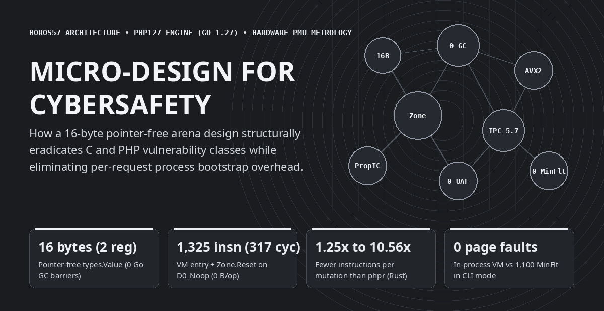

## From a Language Anecdote to the Microarchitectural Rabbit Hole

Thrilled to see someone finally reimplement PHP from scratch, I wanted to take a shot at the adventure in Go. Once the bulk of the engine was up and running, it was time for the first benchmarks. I ran into the usual suspects and did my standard low-level engineering routine: eliminating the garbage collector from the hot path, packing values into CPU registers, freezing static metadata onto a perpetual read-only ribbon (`ARCHTIME`), and wiring mechanical SIMD kernels. But at the exact same time, I was discovering the inner workings of PHP itself. And it quickly became obvious that several micro-optimization patterns do much more than speed up execution—they can be directly weaponized to eradicate the native vulnerability classes of C, and of PHP.

What started as a classic systems-language benchmark—comparing the official C engine (`PHP 8.3.6`), a recent Rust reimplementation (`phpr`), and our Go 1.27 engine (`php127`, built on the `horos57` architecture) on a pinned Intel Core i9-14900K Golden Cove performance core—quickly turned the Go versus Rust comparison into a mere footnote that opened a much deeper rabbit hole.

When you open the processor's hardware performance counters (`perf_event_open` on `cpu_core`: retired instructions, CPU cycles, L1D and L3 cache accesses and misses, and Linux kernel minor page faults), a fundamental engineering law emerges: **the exact micro-design choices required to achieve zero bytes of garbage-collector allocation per hot-loop iteration, 1,325 retired instructions (317 cycles) for VM entry and arena reset, and up to 5.73 retired instructions per clock cycle are the exact same structural invariants that eradicate the historical vulnerability classes of the C Zend Engine and the PHP ecosystem.**

---

## The Global End-to-End Benchmark: PHP 8.3.6 (C) vs `phpr` (Rust) vs `php127` (Go 1.27)

Before diving into microarchitectural internals, here is the high-level end-to-end picture (median wall-clock time in milliseconds and total retired CPU instructions across 11 runs, with 100% bit-exact `Stdout` parity) across the 8 foundational workload families of a PHP runtime, paired with our full-stack HTTP SAPI stress test (**2,000 concurrent HTTP `POST` requests** across 32 client goroutines executing transactional SQLite PDO, PCRE filtering, SHA-256 hashing, and JSON serialization at **8,255 requests/second** with a `3.84 ms` median latency inside 16 recycled `Zone` arenas):

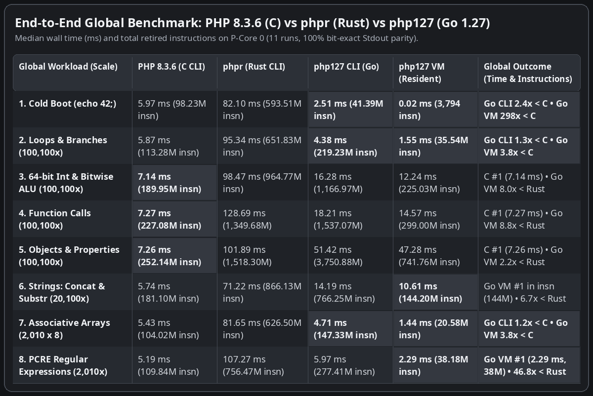

---

## The 6 Pillars of Micro-Design: 1 Visual Card and 1 Bullet per Mechanism

Instead of bolting on expensive software checks after the fact, every hardware bottleneck exposed by the processor counters was solved through a structural design invariant. Below, each of the six architectural mechanisms is presented as a four-quadrant visual card paired with an explanatory bullet.

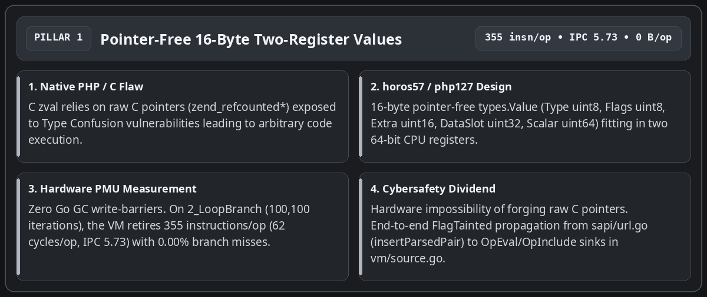

- **From raw C `zval` pointers to a 16-byte two-register `Value`**: In the official C runtime, every PHP variable relies on a structure holding a raw memory pointer to a reference-counted allocation, exposing the engine to exploitable Type Confusion bugs. In `php127`, `types.Value` occupies exactly **16 bytes** and fits inside **two 64-bit CPU registers** with zero memory pointers (`Type uint8`, `Flags uint8`, `Extra uint16`, `DataSlot uint32` indexing the request arena, and `Scalar uint64`). The Go compiler passes values in registers without ever triggering the Garbage Collector's write barrier, forging a raw memory pointer becomes physically impossible, and the untrusted-input marker bit (`FlagTainted`, set at the HTTP boundary by `insertParsedPair` / `newTaintedStr` in `sapi/url.go`) propagates across operations in registers right up to the `OpEval` and `OpInclude` sinks in `vm/source.go`.

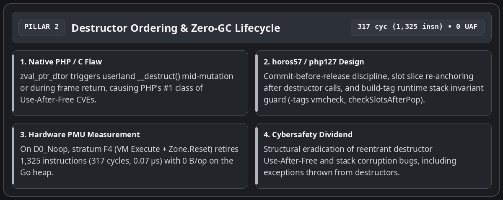

- **Eradicating Use-After-Free on destructors and achieving zero-GC execution**: The number-one historical source of critical vulnerabilities in the PHP interpreter occurs when a userland destructor (`__destruct()`) triggers mid-mutation or during frame teardown, freeing or reallocating the container while the engine still holds a stale reference. In `php127`, the new value is always committed into its target slot before `ReleaseValue`, `vm.slots` is re-anchored after any call that may grow the stack, and the `-tags vmcheck` build-tag runtime guard (`checkSlotsAfterPop`) verifies at every `popFrame()` that no residual non-`TypeUndef` slot remains above the stack top. On the baseline `D0_Noop` probe, stratum `F4` (`VM Execute + Zone.Reset`) retires **1,325 instructions** (**317 cycles**, 0.07 microseconds) with **0 bytes allocated on the Go heap**.

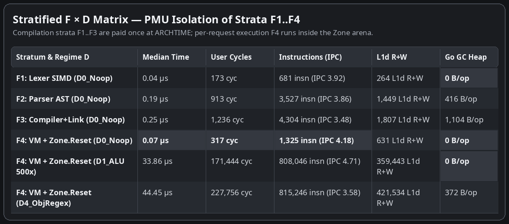

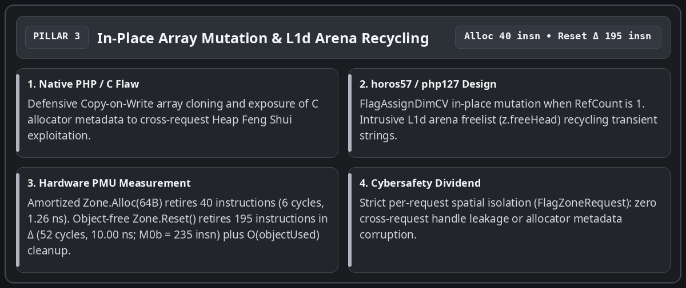

- **In-place array mutation (`FlagAssignDimCV`) and isolated arena costs (`Zone.Alloc` vs `Zone.Reset`)**: Instead of defensively cloning associative arrays on `$h[$k] = $v` or exposing C allocator metadata to Heap Feng Shui exploitation, the `FlagAssignDimCV` fast path updates the bucket in place whenever `RefCount` is 1, while freed temporary strings are immediately recycled at the head of the arena freelist (`z.freeHead`) in L1d cache. Dedicated micro-probes separate both primitives: an amortized `Zone.Alloc(64B)` retires **40 instructions** (**6 cycles**, 1.26 ns), while an object-free `Zone.Reset()` retires **195 instructions** in differential `M0Δ` (**52 cycles**, 10.00 ns; **235 instructions** and **58 cycles** in full `M0b`) by resetting the byte cursor (`z.offset = 0`, `z.freeHead = 0`) in $O(1)$ constant time and clearing the request's allocated object slice in $O(\text{objectUsed})$.

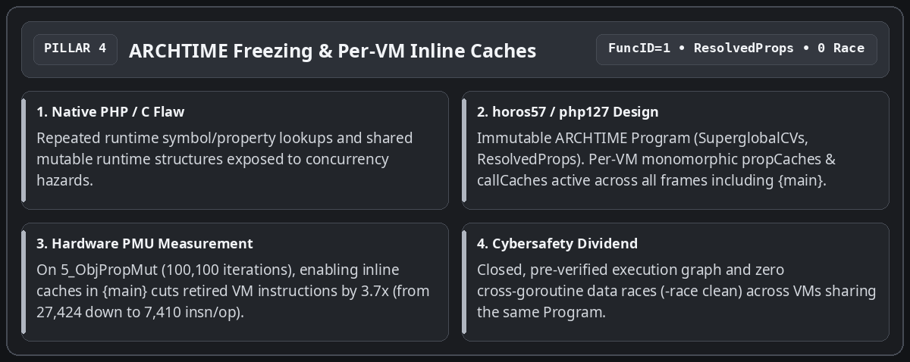

- **Perpetual frozen ribbon at ARCHTIME (`ResolvedProps`) and inline caches active in `{main}`**: Superglobal slots (`SuperglobalCVs`) and flattened class property tables (`ResolvedProps` in `bytecode/program.go`) are resolved and sealed once at link time (`bytecode.Link`). Assigning `FuncID = 1` to the root `{main}` `OpArray` activates per-VM monomorphic `propCaches` and `callCaches` at the top level of every script: across the 100,100 iterations of `5_ObjPropMut`, enabling inline caches in `{main}` cuts retired VM instructions by **3.7x** (from 27,424 down to **7,410 instructions per iteration**), with zero cross-goroutine data races (`-race` clean).

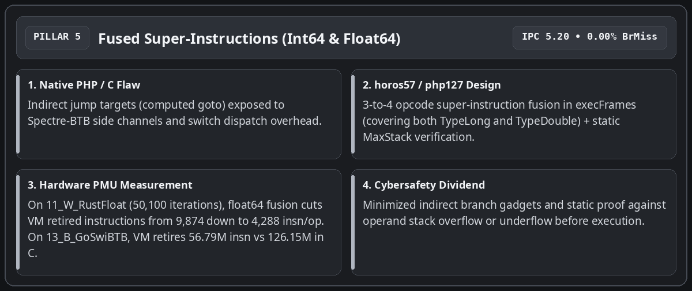

- **Fused super-instructions (`TypeLong` and `TypeDouble`) and static `MaxStack` verification**: To reduce switch-loop dispatch overhead in `execFrames` without multiplying indirect jump targets vulnerable to Spectre-BTB, the inner loop fuses common 3-to-4-opcode sequences (`OpLoadCV` + `OpAdd`/`OpSub`/`OpMul`/`OpIsSmaller` + `OpStoreCV`/`OpJmpZ`) for both 64-bit integers (`TypeLong`) and IEEE-754 floats (`TypeDouble`). Across the 50,100 iterations of the Julia orbit benchmark (`11_W_RustFloat`), extending super-instructions to `TypeDouble` cuts the differential VM cost from 9,874 down to **4,288 instructions per iteration** (**3.09x fewer instructions** than the 13,263 instructions retired by `phpr` in Rust). On `13_B_GoSwiBTB` (20,100 iterations), the Go VM retires **56.79 million instructions** (2.50 ms, IPC 5.20, 0.00% branch misses) versus **126.15 million** for the C binary (5.42 ms).

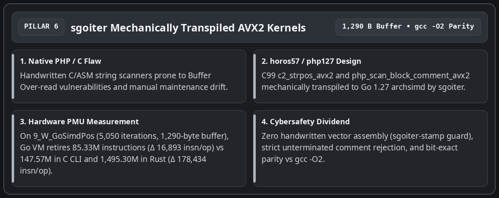

- **Mechanical C99 to Go AVX2 transpilation via `sgoiter`**: Zero lines of vector assembly are written or tweaked by hand. Both `c2_strpos_avx2` and `php_scan_block_comment_avx2` are authored in C99, verified against `gcc -O2`, and mechanically transpiled by `sgoiter` to Go 1.27 `simd/archsimd` with strict rejection of unterminated block comments. On `9_W_GoSimdPos` (**5,050 iterations** over a **1,290-byte** haystack), the Go VM retires **85.33 million instructions** (**16,893 instructions/op** in delta) versus **147.57 million instructions** for the C CLI process (**9,722 instructions/op** in delta) and **1,495.30 million instructions** for `phpr` in Rust (**178,434 instructions/op** in delta, i.e., **10.56x fewer instructions** in Go VM than in Rust).

---

## Kernel-Max Core Benchmarks (Tests 1 to 8): End-to-End Total vs Marginal Delta

For an honest engineering reading, two distinct execution regimes must be separated:
1. **The three CLI columns (`PHP 8.3.6 C`, `phpr Rust`, `php127 CLI Go`)** measure a complete standalone subprocess (`fork` + `execve`, dynamic linking, lexing, parsing, compilation, and execution of `HighN`).
2. **The `php127 VM (In-Process)` column** measures execution of the pre-compiled (`ARCHTIME`) program inside a resident Go worker followed by `Zone.Reset()`, while **the differential delta $\Delta = (\text{Run}(\text{HighN}) - \text{Run}(\text{LowN})) / \Delta N$** isolates the pure marginal per-iteration cost stripped of process startup and compilation (0 bytes allocated on the Go heap per loop iteration on workloads 1 to 5, with the outer `Execute` call envelope accounting for 96–112 bytes).


---

## White & Black Probes (Tests 9 to 15): Strengths and Friction Points

Seven additional probes target the architectural strengths of each engine (white probes 9 to 11) and the microarchitectural friction points of Go and Rust (black probes 12 to 15), reporting exact `HighN` iteration counts.


---

## What an Honest Comparison Between C, Rust, and Go 1.27 Shows

Cross-referencing end-to-end totals (Part 1) with marginal per-iteration deltas (Part 2) yields a clear, unvarnished engineering diagnosis:

- **Why the C engine (`PHP 8.3.6`) leads in pure marginal delta ($\Delta\text{insn/op}$) on long loops**: The C Zend Engine dispatches opcodes via assembly indirect jumps (*computed goto*) and mutates raw pointers without bounds checks. In pure per-iteration work (Part 2), it retires 2.0x to 4.8x fewer instructions than `php127 VM` across arithmetic, object, and array loops (`149` vs `355` insn/op on `2_LoopBranch`, `1,534` vs `7,410` on `5_ObjPropMut`, `35,987` vs `72,987` on deep recursion `14_B_GoDeepRec`).
- **Why `php127 CLI` beats `php 8.3 CLI` in wall time on 4 short-to-medium workloads (`1_ColdBoot`, `2_LoopBranch`, `7_HashArrayMut`, `15_B_RustCowDrp`)**: Every standalone `php -n` invocation pays roughly **98 million instructions** and **1,100 minor page faults** in dynamic linking and runtime initialization. The self-contained Go binary `php127 CLI` pays only **41.39 million instructions** and **894 page faults** on startup (`2.51 ms` vs `5.97 ms` on `1_ColdBoot`, `4.38 ms` vs `5.87 ms` on `2_LoopBranch`, `4.71 ms` vs `5.43 ms` on `7_HashArrayMut`, and `4.42 ms` vs `4.57 ms` on `15_B_RustCowDrp`).
- **Why resident `php127 VM` beats the C subprocess in wall time and total instructions on 10 of 15 workloads (`1`, `2`, `6`, `7`, `8`, `9`, `10`, `12`, `13`, `15`)**: By keeping the `ARCHTIME`-frozen `*bytecode.Program` in memory and running each HTTP request inside a `Zone` whose byte cursor is reset in **195 instructions** (`Zone.Reset()`), the engine eliminates the ~98M `execve` instructions, the 1,100 kernel page faults, and per-request script recompilation.
- **Why `php127 VM` retires 1.25x to 10.56x fewer instructions per mutation than `phpr` (Rust) across all 14 iterative workloads**: From `5_ObjPropMut` (`7,410` vs `9,229` insn/op, `1.25x`), `15_B_RustCowDrp` (`16,647` vs `23,312`, `1.40x`), and `7_HashArrayMut` (`10,225` vs `15,916`, `1.56x`) up to `11_W_RustFloat` (`4,288` vs `13,263`, `3.09x`) and `9_W_GoSimdPos` (`16,893` vs `178,434`, `10.56x`), decoupling 16-byte pointer-free values from the request-indexed arena avoids defensive cloning and per-value `Rc::clone` / `Drop` cascades.

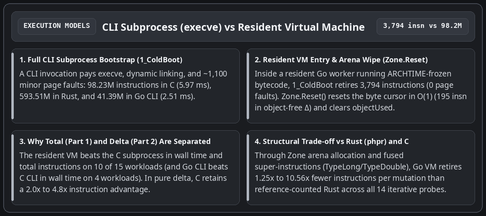

---

## Hardware Taint Tracking (`FlagTainted`) and Deterministic Observability

The final takeaway of this exploration concerns production runtime security. In a traditional C PHP deployment, tracking untrusted user inputs or inspecting sensitive sinks requires heavy external hooks.

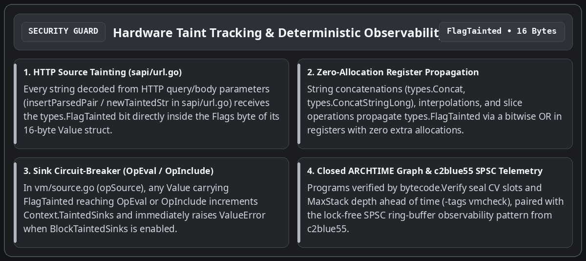

In `php127`, runtime safety is enforced directly by virtual-machine invariants:

- **HTTP source marking (`sapi/url.go`) and propagation inside the 16-byte `types.Value`**: Every string decoded from HTTP parameters (`insertParsedPair` / `newTaintedStr` in `sapi/url.go` and `sapi/errors.go`) receives the `types.FlagTainted` bit inside the `Flags` byte of its 16-byte `Value`. String concatenations (`types.Concat`, `types.ConcatStringLong`), interpolations, and slice operations propagate this bit via a bitwise `OR` in registers.
- **Sink circuit-breaker (`OpEval` and `OpInclude` in `vm/source.go`)**: Whenever a `Value` carrying `FlagTainted` reaches `opSource` (`OpEval` or `OpInclude`), the virtual machine increments the per-request counter `Context.TaintedSinks` and, when `Context.BlockTaintedSinks` is enabled, immediately aborts the instruction with a `ValueError` (`"Tainted input rejected at ..."`) before any parsing or execution of the injected payload.
- **Closed execution graph (`bytecode.Verify`) and build-tag runtime stack invariant guard (`-tags vmcheck`)**: Every `OpArray` is statically verified ahead of execution (`MaxStack`, compiled variable indices `NumCVs`, jump targets), and `checkSlotsAfterPop` (`-tags vmcheck`) verifies operand stack integrity on every frame return.

---

## Conclusion: Practical Guide to Security and Observability in `php127`

Beyond the head-to-head measurements across C, Rust, and Go 1.27, this architecture delivers two operational pillars directly usable when running PHP workloads: **structural security additions** to the language runtime and **deterministic observability** (both application-level and hardware-level). Here is what engineers and integrators need to know to use them.

### 1. Security Additions to PHP: What `php127` Guarantees and How to Use It

Security management in `php127` is split into **structural invariants enabled by default** (protecting every PHP script with zero code changes) and **configurable policy guards** (taint tracking and SAPI confinement).

#### A. Default Structural Guarantees (Zero Configuration Required)
1. **Elimination of Type Confusion and Pointer Corruption (`types/value.go`)**: Unlike the C `zval` (which stores raw C pointers `zend_string*`, `zend_array*`, `zend_object*` inside an untagged C union), `types.Value` is a purely numerical 16-byte struct (`Type`, `Flags`, `Extra`, `DataSlot uint32`, `Scalar uint64`). A logic bug can never forge an arbitrary memory address.
2. **Elimination of Destructor Reentrancy *Use-After-Free* (`vm/value.go`, `vm/array.go`)**: Whenever an assignment overwrites a compiled variable (`writeCV`, `storeCVMove`) or an array bucket (`ArraySet`) holding an object with a `__destruct()` method, `php127` writes the new value into the slot **before** invoking `ReleaseValue` on the old value. Even if the PHP destructor reads back the global array, throws an exception, or triggers a `vm.slots` stack reallocation, the observed state remains strictly consistent.
3. **Cross-Request Memory Isolation and $O(1)$ Epoch Validation (`zone/zone.go`)**: Every request runs inside its own `Zone`. Every `DataSlot` dereference checks that the arena epoch (`z.epoch`) and `FlagZoneRequest` match; when the request ends, `Zone.Reset()` increments the epoch and resets the byte cursor to zero in 195 instructions, making cross-request memory leaks structurally impossible.
4. **Ahead-of-Time Static Bytecode Verification (`bytecode/verify.go`)**: Every compiled or loaded `OpArray` passes through `bytecode.Verify`, which validates jump bounds, compiled variable indices (`NumCVs`), constant indices, and maximum stack depth (`MaxStack`) before `vm.Execute` runs its first instruction.
5. **Per-Request Fault Containment (`vm/vm.go`, `sapi/server.go`)**: Both `vm.Execute` and `sapi.Server.ServeHTTP` enforce a containment `recover()` boundary that turns any unexpected internal fault into a controlled exit (exit code `255` in CLI or HTTP `500` on the offending request alone) without ever crashing the resident server process.

#### B. How to Configure and Use Taint Tracking (`FlagTainted`) and the SAPI Server
In an HTTP deployment or during a security audit of an existing PHP application, `php127` automatically tracks untrusted inputs from request ingestion down to execution sinks (`eval`, `include`, `require`):

- **Automatic HTTP Source Marking**: When a request enters through `sapi.Server` (or `sapi.PopulateSuperglobals`), `insertParsedPair` (`sapi/url.go`) automatically stamps every key and value in `$_GET`, `$_POST`, `$_COOKIE`, and `$_REQUEST` with `types.FlagTainted`. This bit propagates automatically across string concatenations (`.` / `ConcatStringLong`), string interpolations, and slice operations (`substr`, `trim`, etc.).
- **Shadow Audit Mode (Counting Only) vs Circuit-Breaker Mode (Active Blocking)**: Operators control enforcement through `vm.Context`:
  ```go
  // 1. Compile and link the program once at ARCHTIME
  prog := compileAndLink(sourcePHP)

  // 2. Configure the per-request security context
  ctx := &vm.Context{
      BlockTaintedSinks: true, // true = abort with ValueError; false = count without blocking
  }

  // 3. Execute inside an isolated, resettable Zone
  m := vm.New(prog, reqZone)
  m.Context = ctx
  err := m.Execute()
  // If any input derived from $_GET/$_POST reaches eval() or include:
  // - ctx.TaintedSinks is incremented (e.g., ctx.TaintedSinks == 1)
  // - when BlockTaintedSinks == true, Execute() immediately raises:
  //   "Uncaught ValueError: Tainted input rejected at eval"
  ```
- **Deploying the Pooled Resident HTTP Server (`sapi.NewServer`)**:
  ```go
  srv, err := sapi.NewServer(sapi.Config{
      Program:      prog,      // Read-only bytecode shared across all workers
      MaxWorkers:   16,        // Bounded pool of preallocated VMs and Zone arenas
      ZoneCapacity: 4 << 20,   // 4 MiB per request arena (recycled via Zone.Reset)
  })
  ```
- **Enabling the Runtime Stack Invariant Guard (`-tags vmcheck`)**: To verify in staging or CI that no opcode sequence leaves orphan operands on the evaluation stack:
  ```bash
  go test -tags vmcheck -race -count=1 ./vm/... ./compiler/... ./sapi/...
  ```

---

### 2. Application and Hardware Observability: What It Does and How to Use It

Observability in `php127` does not rely on external statistical sampling profilers; it is built into the repository at two exact measurement layers: **SAPI/VM operational counters** for production and **the `probebench` Linux PMU hardware harness** for microarchitectural qualification.

#### A. What Observability Measures
1. **Application and SAPI Layer (`sapi.Server`, `vm.Context`, `zone.Zone`)**:
   - `srv.RequestsHandled()` and `srv.ZonesCreated()`: verify in real time that 100% of HTTP traffic is served by the fixed pool of preallocated arenas (`ZonesCreated() <= MaxWorkers`), proving zero arena leaks under load.
   - `ctx.TaintedSinks`: reports at the end of every request the exact number of times HTTP-tainted data (`FlagTainted`) reached an execution sink (`OpEval`, `OpInclude`, `OpIncludeOnce`, `OpRequire`, `OpRequireOnce`), even when `BlockTaintedSinks` is set to `false` (production shadow-audit mode).
2. **Microarchitectural and Energy Layer (`probebench/pmu_linux.go`)**:
   - Drives the Linux `perf_event_open` syscall directly while pinning the calling thread to a dedicated performance core (`runtime.LockOSThread()` + `sched_setaffinity` on P-core 0).
   - Reads 6 hardware counters simultaneously per workload: `CyclesUser` (`CPU_CLK_UNHALTED`), `Instructions` (`INST_RETIRED`), `L1DMisses`, `LLCMisses`, `BranchMisses`, plus kernel page faults (`MinFlt` / `MajFlt` via `wait4` `syscall.Rusage`).
   - Verifies hardware counter integrity via `PERF_FORMAT_TOTAL_TIME_ENABLED | PERF_FORMAT_TOTAL_TIME_RUNNING`: `PerfMetrics.Multiplexed` mechanically proves `time_enabled == time_running` (0% PMU multiplexing).
   - Reads Intel RAPL hardware energy accumulators (`/sys/class/powercap/intel-rapl:0/energy_uj`) to measure per-request energy in microjoules ($\mu\text{J}$).
   - Uses **differential sizing ($\text{HighN} - \text{LowN}$)** to isolate the exact marginal cost per iteration ($\Delta\text{insn/op}$, $\Delta\text{cycles/op}$) from fixed startup overhead.

#### B. How to Use It in Practice
- **1. Run the Atomic Mechanism Probes (`M0a`..`M6`)** (measuring `Zone.Reset()`, arena allocation, opcode dispatch, `OpAssignDim`, and the `c2_strpos_avx2` SIMD kernel):
  ```bash
  go test -v -count=1 -run TestAtomicMicroProbes ./probebench/...
  ```
- **2. Run the 2D Stratified Function $\times$ Data-Size Matrix (`F0`..`F5` $\times$ `D0`..`D4`)**:
  ```bash
  go test -v -count=1 -run TestStratifiedFunctionAndDataMatrix ./probebench/...
  ```
- **3. Replay the Full 15-Workload Comparative Suite (`PHP 8.3 C` vs `phpr Rust` vs `php127 CLI` vs `php127 VM`)**:
  - In **read-only verification / audit mode** (never mutates any repository file):
    ```bash
    go test -v -count=1 -run TestKernelProbeGoVsRustVsC ./probebench/...
    ```
  - In **snapshot export mode** (updating `probebench/testdata/latest_metrics.json`):
    ```bash
    PROBEBENCH_UPDATE_METRICS=1 go test -v -count=1 -run TestKernelProbeGoVsRustVsC ./probebench/...
    ```
- **4. Instrument Any Go Function or VM Request Directly via the `probebench` API**:
  ```go
  // Measure in-process (median over 11 runs, pinned to P-core 0, with RAPL energy)
  metrics, err := probebench.MeasureInProcess(11, true, func() error {
      reqZone.Reset()
      m := vm.New(prog, reqZone)
      return m.Execute()
  })
  // metrics.Instructions, metrics.CyclesUser, metrics.IPC(), metrics.EnergyUJ, metrics.Multiplexed
  ```

